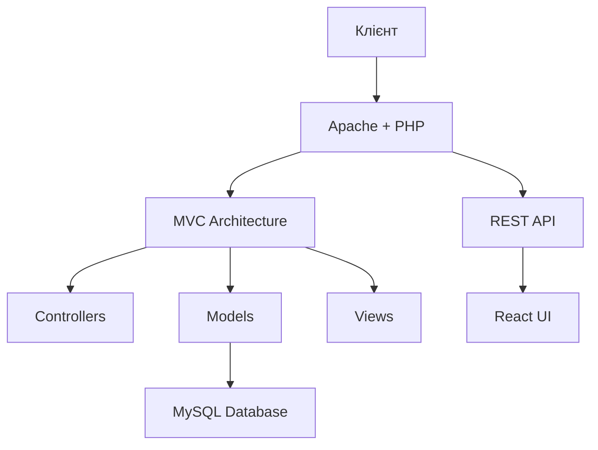
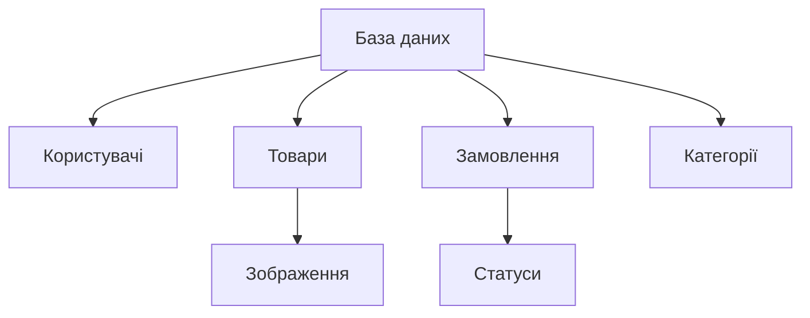

# Документ проєктування інфраструктури (IDD)

## CMS система онлайн-магазину алкогольних напоїв

### Зміст

1. [Огляд системи](#огляд-системи)
2. [Технічна інфраструктура](#технічна-інфраструктура)
3. [Специфікації середовища](#специфікації-середовища)
4. [Безпека та GDPR](#безпека-та-gdpr)
5. [Документація](#документація)
6. [Діаграми](#діаграми)

### Огляд системи

#### Загальний опис архітектури

Система побудована на основі MVC архітектури з використанням PHP 8.x без фреймворків. Проєкт включає як серверну частину (PHP), так і клієнтську частину з компонентним підходом (React + Storybook).

#### Основні компоненти системи

1. **Бекенд (PHP)**
   - MVC архітектура
   - REST API для взаємодії з фронтендом
   - Система автентифікації та авторизації
   - CRUD операції для управління контентом
2. **Фронтенд**
   - React компоненти
   - Storybook для документації UI
   - Адаптивний дизайн
   - Bootstrap іконки
3. **База даних**

   - MySQL для зберігання даних
   - Структурована схема для товарів, користувачів та замовлень

4. **Документація**
   - Swagger для API
   - PHPDoc для бекенду
   - Storybook для UI компонентів

### Технічна інфраструктура

#### Серверні вимоги

- **Веб-сервер**
  - Apache з підтримкою .htaccess
  - PHP 8.x
  - Node.js для фронтенд-інструментів
  - Мінімальні характеристики:
    - CPU: 2 cores
    - RAM: 4 GB
    - Дисковий простір: 20 GB

#### Структура проєкту

```
root/
├── src/           # Основний код PHP
├── react-ui/      # React компоненти
├── controllers/   # MVC контролери
├── models/        # MVC моделі
├── views/         # MVC представлення
├── config/        # Конфігурації
├── database/      # SQL файли та міграції
├── docs/          # Згенерована документація
└── public/        # Публічні файли
```

### Специфікації середовища

#### Технологічний стек

1. **Бекенд**

   - PHP 8.x
   - MySQL
   - Apache
   - Composer (якщо є)

2. **Фронтенд**

   - React
   - Storybook
   - Bootstrap Icons
   - Vitest для тестування

3. **Розробка та тестування**
   - Git для версіонування
   - Swagger для API документації
   - PHPDoc для документації коду
   - Vitest + Playwright для тестування

### Безпека та GDPR

#### Заходи безпеки

1. **Автентифікація та авторизація**

   - Система логіну та паролю
   - Сесійна автентифікація
   - Розділення прав доступу

2. **GDPR відповідність**

   - Cookie consent банер
   - Класифікація cookie:
     - Обов'язкові
     - Функціональні
     - Аналітичні
   - Політика конфіденційності
   - Документація щодо обробки даних

3. **Захист даних**
   - Валідація форм
   - Захист від SQL-ін'єкцій
   - XSS захист
   - HTTPS

### Документація

#### Технічна документація

1. **API документація**

   - Swagger UI (http://localhost:3001/api-docs)
   - REST API endpoints
   - JSON специфікації

2. **Компонентна документація**

   - Storybook для UI компонентів
   - Інтерактивні приклади
   - Документація пропсів

3. **Код документація**
   - PHPDoc для PHP коду
   - JSDoc для JavaScript
   - Автоматична генерація

### Діаграми

#### Архітектурна діаграма



#### Структура даних


